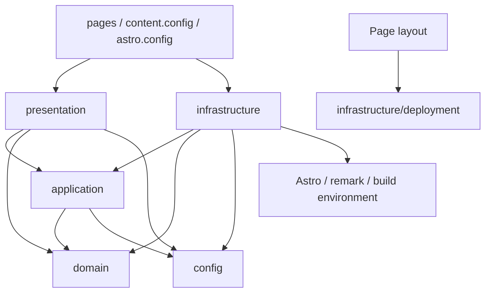

# ブログのアーキテクチャと品質契約

## 設計の前提

読者が記事を読み、一覧・タグ・関連記事をたどれることと、筆者が記事を安全に追加・公開できることを中心に設計する。Astroの静的生成を維持し、責務と依存方向を明確にしたモジュール構成を採用する。

基準は [ISO/IEC 25010:2023](https://www.iso.org/standard/78176.html) の製品品質モデル（9特性）。2011年版の8特性とは区別する。以下の優先度・合格条件・容量予算は、このブログに合わせた設計判断であり、規格の規定値や適合認証を表すものではない。特性の用語は [ISO規格を採用したGSOの公開プレビュー](https://gso-sims-preview-doc-aws.s3-eu-west-1.amazonaws.com/gso-iso-iec-25010-2025-en.html) も参照した。

Astro 7.4.7、TypeScript、標準CSS・DOM、Tabler、remark/unified、Vercel、Node.js 24、pnpm 10.8.0、Vitest・ESLint・Prettierを継続する。依存パッケージとlockfileは変更しない。記事本文、公開URL、画像、RSS、SEO、表示・操作も維持する。

## 採用する構造

```text
src/
  config/
    site.ts                    サイトの公開情報
    deployment.ts              入力された環境から公開可否を決める純粋な規則
  domain/
    posts.ts                   記事型、タグ、日付、URL、公開時の不変条件
  application/
    catalog.ts                 記事の検証・整列・索引と一覧／隣接／関連の問い合わせ
    metadata.ts                canonical、OGP、JSON-LD、共有URLの方針
  infrastructure/
    deployment.ts              ビルド環境変数を読む唯一の場所
    content/
      collection.ts            AstroのスキーマとMarkdown loader
      posts.ts                 Content Collectionsから要約と本文を取得
      remark.ts                抜粋・注意書き・画像・表のMarkdown変換
  presentation/
    layouts/Page.astro         HTML全体、公開設定と表示の組み立て
    views/                     記事一覧・記事詳細の画面
    components/
      site/                    head、ナビゲーション、フッター、GTM
      blog/                    要約、タグ、共有、前後・関連記事
      Icon.astro               アイコンの共通表示規則
    client/interactions.ts     コピーと先頭復帰の段階的な機能追加
    styles/                    base、shell、blogと読み込み順
  content/posts/               原稿と原画像（従来の場所を維持）
  content.config.ts            コレクションの登録だけを担うAstro入口
  pages/                      URL、静的パス生成、画面とRSS／robotsの組み立て
tests/
  unit/                       domain／application／config／adapterと依存境界
  build/output.test.ts        移行時の33記事・48公開URLを守る固定回帰検査
  build/quality.test.ts       生成された全HTMLへ適用する継続品質検査
scripts/
  eslint/architecture.mjs      依存方向と環境変数のアクセス境界
  verify.mjs                  ローカルとCI共通の品質ゲート
  verify-deployment.mjs        公開後のHTTP契約検査
```



`pages` は入力元と表示をつなぐ場所。記事詳細ルートでだけ本文とOGP画像を描画し、ビューには要約データと本文slotを渡す。`Page.astro` が公開設定を読み、`PageHead` へ値で渡すことだけを、表示層から基盤層への例外とする。

### 依存の規則

| モジュール            | 許可する内部依存                                    | 外部ライブラリ・実行環境                              |
| --------------------- | --------------------------------------------------- | ----------------------------------------------------- |
| `domain`              | `domain`                                            | 不可                                                  |
| `config`              | `config`                                            | 不可。環境値は引数で受ける                            |
| `application`         | `application`, `domain`, `config`                   | 不可                                                  |
| `infrastructure`      | `infrastructure`, `application`, `domain`, `config` | Astro、remark、ビルド環境                             |
| `presentation`        | `presentation`, `application`, `domain`, `config`   | Astro表示・Tabler。上記layout例外のみ許可             |
| `presentation/client` | 同じ`client`内だけ                                  | 標準DOM。ビルド用モジュールとパッケージを持ち込まない |
| `pages`               | 上記の各層                                          | 必要なAstro API、RSS                                  |

`pnpm lint` のローカルESLintルールでimport・re-export・動的import・型だけのimportを検査する。`import.meta.env` と `process.env` は `infrastructure/deployment.ts` に集約する。外部ライブラリ欄は設計方針であり、自動検査ではdomain・application・config・clientの外部依存禁止を強制する。presentation・infrastructureのパッケージ別許可リストまでは強制しない。境界ルール自体にも逆向き依存の回帰テストを置く。ブラウザー・ファイル・ネットワークへのアクセスを追加するときは、純粋な規則へ混ぜず、基盤または表示側に配置する。

## 主な設計判断

### 記事カタログと描画を分ける

旧 `getPosts()` は一覧・RSSも含め、取得のたびに全記事を `render()` し、本文コンポーネントを返していた。新しい `getPostCatalog()` は、Astroの公開型 `RenderedContent.metadata.frontmatter` に保存された抜粋を読み、本文を持たない要約を生成する。抜粋は既存remarkツリーから一度生成し、本文を再パースしない。

`createPostCatalog()` は公開条件を検証し、記事をコピーして日付順に整列、ID位置とタグを索引化する。同じスナップショットから新着・分類・タグ件数・隣接・関連記事を返す。配列と記事・タグを凍結し、呼び出し元の変更で索引が壊れないようにする。索引は一度の取得内で共有し、一覧表示から本文のレンダラーを参照しない。

`renderPost()` は記事詳細でだけ使用する。プロセス全体のPromiseキャッシュは設けず、キャッシュとファイル監視はAstroに任せる。これにより開発中の原稿更新を古い一覧で隠さない。[Astro Content Collections](https://docs.astro.build/en/guides/content-collections/) と [Content Loader API](https://docs.astro.build/en/reference/content-loader-reference/) を参照。

### 公開設定とメタデータを一元化する

環境変数を読む処理と `deploymentSettings()` の判断を分離する。純粋な規則のテストを読み込むだけで実際の環境を評価しない。既存の本番GTM必須、Vercel環境優先、プレビューの検索・計測抑制を維持する。

サイトのoriginは `config/site.ts` からAstro設定とアプリへ供給する。記事の公開日・URLはdomainに、canonical・共有URL・JSON-LD・共通OGP画像は `application/metadata.ts` に集める。JSON-LDを埋め込む際は `<` をエスケープし、タイトルなどがscript要素を終了できないことを検査する。

### 表示は静的HTMLを基本とする

`Page` は文書の骨格、サイト部品は共通表示、`PostIndex` と `PostArticle` は画面を担当する。ルートで一覧UIを複製しない。CSSは既存の宣言をbase・shell・blogへ分け、読み込み順を明示する。標準DOMの38行の操作コードは責務が小さいため、不要なイベント基盤やクラスに分割しない。

本文・ナビゲーション・共有リンクはJavaScriptなしで利用できる。コピー操作と浮動の先頭復帰リンクだけをJavaScriptで有効にする。コピー処理中・成功・失敗は通知領域へ表示し、先頭復帰ではキーボードフォーカスを移す。

### この規模で追加しないもの

単一の原稿取得元に対する汎用Repository、DIコンテナー、マイクロサービス、SSR、クライアントUIランタイム、独自キャッシュは導入しない。取得元を変更する場合はまず `infrastructure/content` の実装を変え、実際に複数の実装が必要になった時点で境界のインターフェースを検討する。

## ISO/IEC 25010との対応

| 品質特性・優先度 | このブログでの設計と合格条件                                                                                       | 検証と残る運用上の確認                                                                                                   |
| ---------------- | ------------------------------------------------------------------------------------------------------------------ | ------------------------------------------------------------------------------------------------------------------------ |
| 機能適合性・高   | 記事、分類、タグ、前後・関連、新着5件、RSS、SEOの振る舞いを保持                                                    | domain/catalog/metadata単体テストと固定回帰検査。33記事の本文ハッシュ、48公開URLを照合                                   |
| 性能効率性・高   | 静的配信、一覧で本文renderを呼ばない。画像を拡大せず複数サイズ生成。自サイトの実行JSを未圧縮4 KiB/ページ以内       | adapterの呼出検査と生成画像・JS容量検査。配信遅延・実ユーザーのWeb Vitalsは公開環境で別途測定                            |
| 互換性・高       | 従来URL・旧画像、RSS、サイトマップ、canonical、通常のHTMLリンクを保持                                              | 固定回帰・全HTMLのローカルリンク検査。Vercelの転送とHTTPヘッダーは公開後の検査で確認                                     |
| 相互作用能力・高 | 見出しとランドマーク、スキップリンク、ARIA参照、通知とフォーカス、JS無効時の閲覧を維持                             | 全HTMLの構造検査とPC/モバイル幅のブラウザー操作。支援技術・複数ブラウザーの総合評価は別途必要                            |
| 信頼性・高       | 不正日付、ID重複、未定義・重複タグ、空タイトル、抜粋欠落を公開前に失敗させる。読み取り元の変更でカタログを壊さない | 異常系単体テスト、本番/プレビュー両ビルド、参照アセットの実在検査。配信障害・復旧はVercel運用と公開後確認の対象          |
| セキュリティ・高 | 環境境界、GTM値の検証、JSON-LDエスケープ、不要なサーバー実行の排除                                                 | 環境・メタデータ・依存境界テスト。原稿とraw HTMLはリポジトリ筆者の信頼済み入力。外部投稿を受ける場合は別途入力保護が必要 |
| 保守性・高       | 記事規則・取得・公開方針・表示の変更場所を特定できる。逆向き依存を禁止                                             | ESLint、境界ルールの単体テスト、型検査。変更レビューでは責務・変更範囲・重複した判断を確認                               |
| 柔軟性・中       | 主要規則をAstroから独立させ、静的成果物の配信と内容取得の変更を局所化                                              | 純粋モジュールの外部依存禁止とadapterテスト。別ホストへの移転時はVercel固有の転送・保護設定を再検証                      |
| 安全性・低       | 人・財産・環境を直接制御する機能がないため低優先。記事中の注意書きと警告の内容を欠落させない                       | 既存の警告文・注意書き・本文ハッシュを照合。安全性とアクセス制御・情報保護を混同しない                                   |

4 KiBは変更前の操作スクリプト842 bytesに修正余地を持たせた、このプロジェクトの予算。インライン実行スクリプトとローカルimport先を合算し、JSON-LDは除外する。本番GTMの起動コードは含めるが、外部GTMから配信されるコードは含めない。

`noindex` と `robots.txt` は検索抑制であり、アクセス制御ではない。非公開プレビューの保護は既存のVercel認証を使用する。品質検査はGTMへの送信、実デプロイ、アクセス権の変更を行わない。

## 検証経路と今回の確認

標準経路は `pnpm verify`。型・依存境界を含むlint・format・単体テストを実行し、ダミーGTM IDによる本番ビルドと生成物検査、その後にプレビュービルドと生成物検査を実行する。本番検査後は、失敗時もプレビューの再ビルドを試みる。正常終了時の `dist/` は検索・計測が無効なプレビューとなる。`.github/workflows/quality.yml` も同じコマンドを使用する。個別の手順は [開発規約](development.md) を参照。

今回の `pnpm verify` では、型検査のエラー・警告・ヒントが0件、単体テスト88件、本番・プレビューそれぞれ生成物テスト44件が成功した。GitHub Actionsでの実行はpush後に確認する。

今回の再構成では既存の40件の生成物回帰検査を変更せず、新しい継続品質検査4件を追加した。継続検査は固定fixtureに依存せず、404を含むすべての生成HTMLへ適用する。固定fixtureは移行証拠として `docs/astro-migration/` に残す。今後の記事追加・意図的な本文変更では、その比較データの更新も必要となる。

Chromiumでは10ルートを1280px/390pxの計20ケースで変更前と比較し、本文・タイトル・主要要素の位置、寸法、字体、色、グリッドが一致した。横方向のはみ出しと実行時エラーはなかった。コピーの処理中・成功・失敗、先頭復帰とフォーカス、スキップリンク、JavaScript無効時の閲覧も確認した。コピーはブラウザー内でClipboard境界を差し替えて確認し、実OSのクリップボードやGTM送信は使用していない。

設計レビューの補助として使用した8項目の診断では、現時点で7/8（8.75/10）を確認した。責務の明確さ、変更影響の局所化、境界の理解しやすさは、責務分離、判断の集約、依存図と自動検査で改善した。未確認の1項目は、設計改善へ継続的に時間を割く運用の定着である。今後の変更で設計改善に時間を確保した実績をレビューし、確認できれば8/8とする。これはISOの評点ではなく、継続的な設計レビューのための目安である。

## 変更時に参照する場所

- 記事や画像の追加: `src/content/posts/` と [記事・画像の規約](development.md#記事と画像)。
- タグ・公開日・URLの規則: `domain/posts.ts`。取得元と画面の双方で同じ規則を使う。
- 一覧・関連記事の選び方: `application/catalog.ts`。ビューで再ソート・再集計しない。
- サイトの公開情報・SEO: `config/site.ts` と `application/metadata.ts`。
- 公開環境・計測: `config/deployment.ts` と `infrastructure/deployment.ts`。表示部品から環境変数を直接読まない。
- UI: `presentation`。見た目の修正でdomainや取得処理を変更する必要がないか確認する。

変更レビューでは「この変更で複雑さが減るか」「同じ判断を複数箇所へ漏らしていないか」「既存の単純な境界で解決できるか」を確認する。機能追加でも設計改善の時間を確保し、規約の重複はこの文書への参照に置き換える。
